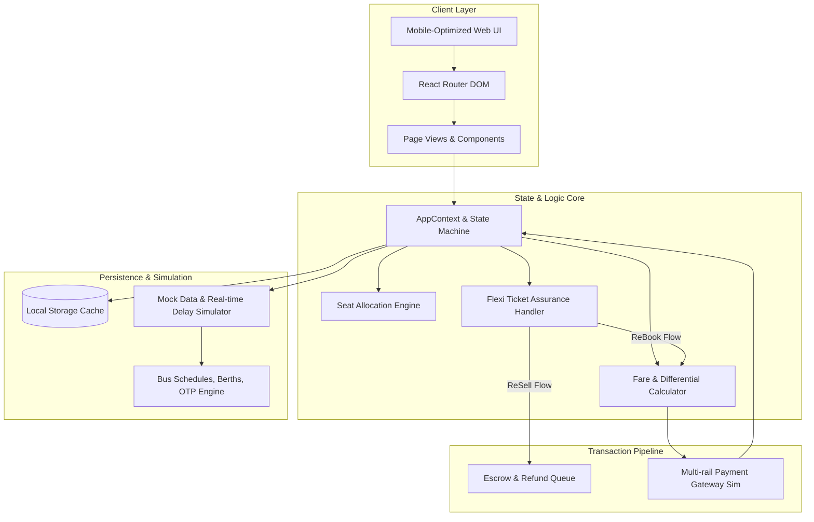
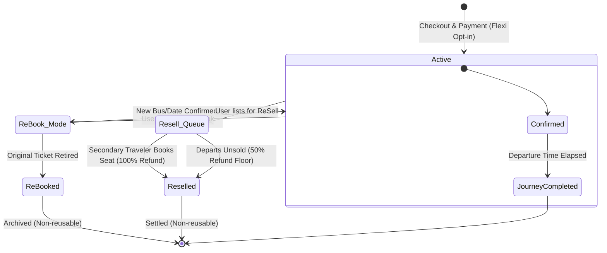

<div align="center">

# 🚌 Abhi’s SeatSure
### *Next-Generation Bus Ticketing Platform with Zero-Loss Travel Flexibility*

[](https://react.dev/)
[](https://www.typescriptlang.org/)
[](https://vitejs.dev/)
[](https://tailwindcss.com/)
[](https://www.radix-ui.com/)
[](https://opensource.org/licenses/MIT)

<br />


<br />

**A production-grade, mobile-first bus ticketing ecosystem engineered to solve the #1 consumer pain point in intercity travel: forfeiture of funds due to rigid cancellation policies.**

[🎥 Watch Live Demo Video](https://youtu.be/vEWwVCTm71Q?si=mWjMJQd7L26SeznS) • [📑 View Pitch & Architecture Deck](https://docs.google.com/presentation/d/1gKEXBtCgD0xh0pWyVYrHdJN70ZcZfsDi/edit?usp=drive_link&ouid=108722834440786058159&rtpof=true&sd=true) • [👤 Author Profile](https://www.linkedin.com/in/rakesh-babu-gajula/)

</div>

---

## 📑 Table of Contents

- [Executive Summary](#-executive-summary)
- [The Problem vs. The Solution](#-the-problem-vs-the-solution)
- [Core Innovation: The Flexi Ticket Engine](#-core-innovation-the-flexi-ticket-engine)
  - [1. Smart ReBook Engine](#1-smart-rebook-engine)
  - [2. Peer-to-Peer (P2P) ReSell Protocol](#2-peer-to-peer-p2p-resell-protocol)
- [System Architecture & Data Flow](#-system-architecture--data-flow)
- [Ticket Lifecycle Finite State Machine (FSM)](#-ticket-lifecycle-finite-state-machine-fsm)
- [Complete Feature Catalog](#-complete-feature-catalog)
- [Technology Stack & Design Decisions](#-technology-stack--design-decisions)
- [Repository Structure](#-repository-structure)
- [Data Models & TypeScript Schema](#-data-models--typescript-schema)
- [Local Setup & Development Guide](#-local-setup--development-guide)
- [Business Impact & Unit Economics](#-business-impact--unit-economics)
- [Future Engineering Roadmap](#-future-engineering-roadmap)
- [Author & Acknowledgements](#-author--acknowledgements)

---

## 📌 Executive Summary

**Abhi’s SeatSure** is an enterprise-inspired consumer travel application modeled after industry leaders like **AbhiBus** and **redBus**. It reimagines the post-booking passenger experience by introducing **Flexi Ticket** — an algorithmic travel protection add-on (₹50) that eliminates financial loss from unforeseen travel changes.

Instead of penalizing users with standard **50%–100% cancellation fee penalties**, SeatSure gives passengers two automated recovery mechanisms:
1. **ReBook**: Dynamically shift your travel date, bus operator, or seat class by paying only the marginal fare difference (if any).
2. **ReSell**: Re-list unneeded seats back onto the active seat inventory. If bought by another passenger before departure, the user recovers **100% of the base fare**; if unsold, an automated **50% minimum refund safety net** is triggered.

> 💡 **Origin Story**: *Born out of real-world friction experienced during an urgent journey cancellation where 80% of ticket value was lost to non-refundable fees. SeatSure proves that modern booking platforms can simultaneously protect customer capital, reduce friction, and unlock high-margin ancillary revenue.*

---

## ⚖️ The Problem vs. The Solution

```
┌────────────────────────────────────────────────────────┐
│               TRADITIONAL BUS BOOKING                  │
├────────────────────────────────────────────────────────┤
│ ❌ Rigid cancellation schedules (50%-100% deductions)   │
│ ❌ Zero credit transfer across different dates         │
│ ❌ Last-minute emergencies guarantee total cash loss   │
│ ❌ High customer churn and negative brand sentiment    │
│ ❌ Empty seats produce zero secondary marketplace GMV  │
└────────────────────────────────────────────────────────┘
                           ⬇️
┌────────────────────────────────────────────────────────┐
│              ABHI'S SEATSURE INNOVATION                │
├────────────────────────────────────────────────────────┤
│ ✅ ₹50 Micro-Insurance Add-On during checkout          │
│ ✅ Zero cancellation penalties on date/bus changes     │
│ ✅ Automated dynamic fare delta calculations           │
│ ✅ Secondary P2P resale with 100% money-back potential │
│ ✅ 50% guaranteed floor refund fallback protection     │
│ ✅ Win-win: Higher user loyalty & platform margin      │
└────────────────────────────────────────────────────────┘
```

---

## ⚡ Core Innovation: The Flexi Ticket Engine

For an optional add-on of **₹50**, passengers activate an intelligent travel assurance policy governing their booking lifecycle.

### 1. Smart ReBook Engine
Enables passengers to reschedule their itinerary without forfeiting their existing ticket value.

* **Eligibility Invariants**:
  * Flexi Ticket add-on active on booking.
  * Initiated strictly prior to scheduled departure.
  * Permitted once per booking to prevent speculative hoarding.
* **Algorithmic Pricing Logic**:
  $$\text{Payable Amount} = \max(0, \text{Fare}_{\text{new}} - \text{Fare}_{\text{old}})$$
  * $\text{Fare}_{\text{new}} > \text{Fare}_{\text{old}}$: User pays solely the net differential.
  * $\text{Fare}_{\text{new}} \le \text{Fare}_{\text{old}}$: Seamless 1-click rebooking with zero out-of-pocket expense.
* **Audit Trail**: The prior booking is atomically retired with status `ReBooked` and linked to the new ticket via `originalBookingId`.

### 2. Peer-to-Peer (P2P) ReSell Protocol
Allows passengers who can no longer travel to liquidate their seat back to high-demand travelers.

* **Marketplace Re-listing**: Seat(s) instantly return to available inventory for incoming queries on that route.
* **100% Principal Recovery**: If another traveler books the seat prior to departure, a full 100% refund of base fare is credited back.
* **50% Guaranteed Floor Refund**: If the bus departs without secondary matching, an automated 50% fallback refund executes, slashing customer loss in half.
* **Transparent Escrow**: Add-on premium (₹50) remains non-refundable, securing positive unit economics for the platform.

| Parameter | Standard Cancellation (Industry) | SeatSure ReBook | SeatSure ReSell (Matched) | SeatSure ReSell (Unmatched) |
| :--- | :---: | :---: | :---: | :---: |
| **Allowed Modification** | None (Forfeit Only) | Date, Operator, Berth | None | None |
| **Deduction Rate** | 50% - 100% | 0% | 0% | 50% Floor |
| **Additional Fee** | Heavy cancellation penalty | Only fare delta (if higher) | ₹0 | ₹0 |
| **Refund Processing** | 7-14 Days | Instant seat switch | 5-7 Business Days | 5-7 Business Days |

---

## 🏛️ System Architecture & Data Flow

The platform is designed around a modular React + TypeScript architecture utilizing client-side reactive stores, optimistic updates, and persistent localStorage sync.



---

## 🔄 Ticket Lifecycle Finite State Machine (FSM)

Each booking transitions through deterministic states enforcing strict business rules:



---

## 🚀 Complete Feature Catalog

### 🔐 1. Authentication & Security Handshake
- Mobile number input validation with Indian telecom prefix standards (10-digit format check).
- Instant multi-digit SMS OTP generation and verification flow with interactive demo toast triggers.
- Session persistence preserving active credentials across browser refreshes.

### 🔍 2. Intelligent Route Search & Bus Discovery
- Source and destination city selectors supporting major metro hubs (Hyderabad, Bangalore, Chennai, Mumbai, Delhi, Pune, Vizag, Vijayawada).
- Calendar selector integrated via `date-fns` with journey day formatting.
- Instant 1-click city swap toggle.
- Real-time catalog filtering: **AC**, **Non-AC**, **Sleeper**, **Seater**, and operator rating badges.

### 💺 3. Interactive 2-Tier Deck Seat Matrix
- **Dual-Deck Visualization**: Lower Deck (`L1`–`L18`) and Upper Deck (`U1`–`U18`) berth configurations.
- Real-time status indicators: **Available**, **Selected**, **Booked**, and **Ladies Reserved**.
- Dynamic sleeper layout (2+1 format with central aisle).
- Interactive seat limits (maximum 6 seats per transaction) with auto-updating gross fare computations.

### 🛡️ 4. Flexi Ticket Upsell & Checkout Flow
- High-conversion upsell modal explaining zero-loss benefits in clear microcopy.
- Multi-passenger form handling: Dynamic fields for passenger names, age verification, and gender tags linked directly to berth assignments.
- Transparent price breakdown: Base Fare + Flexi Fee (₹50) = Total Payable.

### 💳 5. Unified Simulated Payment Gateway
- Multi-rail payment options: **UPI** (GPay, PhonePe, Paytm), **Credit/Debit Cards**, **Net Banking**, and **Digital Wallets**.
- Asynchronous settlement simulation with loader animations and optimistic UI updates.
- Dynamic ReBook settlement logic: Auto-bypasses payment if new fare $\le$ previous fare.

### 📂 6. Comprehensive Ticket Management & Dashboard
- Active vs. Historical booking tabs with distinct status pills (`Active`, `ReBooked`, `Reselled`).
- Deep ticket inspection view featuring booking ID, QR placeholder, passenger manifest, route timeline, and operator contact details.
- Integrated **Abhicash** digital rewards wallet tracking loyalty balance and referral bonuses.
- Dedicated help center and profile configuration panels.

---

## 💻 Technology Stack & Design Decisions

| Category | Technology | Rationale & Impact |
| :--- | :--- | :--- |
| **Framework** | **React 18** | Concurrent rendering features, functional components, hooks-based architecture. |
| **Language** | **TypeScript 5.8** | Complete static type safety for complex booking, bus, and passenger domain entities. |
| **Build Tool** | **Vite 5.4** | Ultra-fast HMR (Hot Module Replacement) and optimized production rollup bundling. |
| **Styling** | **Tailwind CSS 3.4** | Utility-first responsive CSS styling with custom design tokens for mobile ergonomics. |
| **Component Primitives** | **Radix UI** | Accessible, unstyled UI primitives (Dialogs, Popovers, Accordions, Tabs, Tooltips). |
| **Icons** | **Lucide React** | Consistent, modern vector iconography across all device form factors. |
| **State Management** | **React Context + Hooks** | Centralized, reactive state store with automated `localStorage` cache synchronization. |
| **Data Fetching** | **TanStack Query v5** | Future-proof server-state management, cache invalidation, and async workflows. |
| **Notifications** | **Sonner + Shadcn Toast** | Non-blocking, beautiful feedback notifications for transaction events. |
| **Form Handling** | **React Hook Form + Zod** | High-performance, schema-validated input pipelines. |

---

## 📁 Repository Structure

```
abhi-seat-sure/
├── public/                       # Static public assets, favicon, and graphics
├── temp_src/                     # Application source tree (configured via vite aliases)
│   ├── components/               # Modular UI building blocks
│   │   ├── ui/                   # Reusable Radix UI & Shadcn primitives (Button, Dialog, Popover, etc.)
│   │   ├── BottomNav.tsx         # Mobile app bottom navigation bar
│   │   ├── ErrorBoundary.tsx     # React runtime crash containment
│   │   ├── LoadingSpinner.tsx    # Branded progress indicator
│   │   ├── NavLink.tsx           # Route-aware navigation links
│   │   └── StatusBadge.tsx       # Color-coded ticket state badges
│   ├── context/
│   │   └── AppContext.tsx        # Central state orchestrator (Auth, Bookings, ReBook/ReSell FSM)
│   ├── data/
│   │   └── mockData.ts           # Intercity routes, operators, sleeper configurations, seed data
│   ├── hooks/
│   │   ├── use-mobile.tsx        # Breakpoint viewport detector
│   │   └── use-toast.ts          # Reactive toast dispatcher
│   ├── lib/
│   │   └── utils.ts              # ClassName merge utilities (clsx + twMerge)
│   ├── pages/                    # Routed application screens
│   │   ├── AbhicashPage.tsx      # Loyalty rewards & referral wallet view
│   │   ├── AccountPage.tsx       # Profile management and user preferences
│   │   ├── BookingsPage.tsx      # Ticket catalog (Active, Past, Resold)
│   │   ├── BusListPage.tsx       # Filterable operator inventory & timings
│   │   ├── HelpPage.tsx          # FAQ & customer support portal
│   │   ├── HomePage.tsx          # Hero journey search & city selector
│   │   ├── Index.tsx             # Auth router guard & entrypoint
│   │   ├── LoginPage.tsx         # Mobile phone & OTP authentication
│   │   ├── NotFound.tsx          # 404 fallback page
│   │   ├── PassengerDetailsPage.tsx # Manifest builder & Flexi Ticket opt-in
│   │   ├── PaymentPage.tsx       # Multi-rail checkout & fare delta reconciler
│   │   ├── SeatSelectionPage.tsx # Interactive Upper/Lower sleeper berth map
│   │   └── TicketDetailsPage.tsx # Digital pass, ReBook modal & ReSell triggers
│   ├── types/
│   │   └── index.ts              # Domain interfaces (User, Booking, Bus, Passenger)
│   ├── App.css                   # Global layout styling
│   ├── App.tsx                   # Route provider & core app wrapper
│   ├── index.css                 # Tailwind design tokens, typography & CSS variables
│   └── main.tsx                  # Application bootstrap
├── index.html                    # HTML shell
├── package.json                  # Dependencies and execution scripts
├── tailwind.config.ts            # Custom themes, color palettes, and animation keyframes
├── tsconfig.json                 # TypeScript compiler configuration
└── vite.config.ts                # Vite dev server and path resolution
```

---

## 🧩 Data Models & TypeScript Schema

The core domain relies on typed data structures ensuring predictable state transitions:

```typescript
export interface Booking {
  id: string;
  userId: string;
  from: string;
  to: string;
  date: string;
  time: string;
  busName: string;
  busType: string;
  seats: string[];
  passengers: Passenger[];
  fare: number;
  flexiPurchased: boolean;
  flexiFee: number;
  status: 'Active' | 'Reselled' | 'ReBooked';
  createdAt: string;
  originalBookingId?: string; // Links back to superseded booking upon ReBook
}

export interface Bus {
  id: string;
  name: string;
  type: string;
  departureTime: string;
  arrivalTime: string;
  duration: string;
  seatsAvailable: number;
  totalSeats: number;
  price: number;
  rating: number;
  amenities: string[];
  bookedSeats: string[];
}
```

---

## 🛠️ Local Setup & Development Guide

Follow these steps to run the project locally on your machine:

### Prerequisites
- **Node.js**: v18.0.0 or higher
- **npm** (v9+) or **bun** (v1.0+) or **yarn**

### 1. Clone the Repository
```bash
git clone https://github.com/RakeshBabuGajula/my_portfolio.git
cd abhi-seat-sure-main
```

### 2. Install Dependencies
```bash
npm install
```

### 3. Launch the Development Server
```bash
npm run dev
```
The application will launch locally at `http://localhost:8080` (or `http://localhost:5173`).

### 4. Build for Production
To generate an optimized production bundle:
```bash
npm run build
```

---

## 📈 Business Impact & Unit Economics

If implemented across major OTA platforms like **AbhiBus** or **redBus**, SeatSure transforms ticket flexibility into a recurring profit center:

1. **High-Margin Ancillary Revenue**:
   * At an attach rate of $20\%$ across 100,000 daily bookings, a ₹50 add-on yields **₹10,00,000 (~$12,000 USD) in daily pure margin** with negligible underwriting cost.
2. **Cancellation Churn Reduction**:
   * Instead of frustrating users with 50-100% penalties that push them to competitors, customers retain equity on the platform through ReBook or secondary ReSell.
3. **Secondary Market Velocity**:
   * Resold seats are recycled back into active inventory, allowing the platform to earn double convenience charges on the same physical seat.
4. **Trust-Driven Booking Conversion**:
   * Mitigating cancellation anxiety unlocks earlier booking windows, improving bus operator route predictability.

---

## 🔮 Future Engineering Roadmap

- [ ] **AI Resale Probability Scoring**: Train an ML model on historical route occupancy to display real-time sell-through likelihood (e.g., *"94% chance of resale on this route"*).
- [ ] **Real-Time WebSocket Sync**: Multi-user seat reservation locks with TTL timers to prevent concurrent collisions.
- [ ] **Automated UPI Payment Gateways**: Integration with Razorpay / Cashfree webhooks for instant payout disbursements.
- [ ] **Mobile Native Build**: React Native / Expo packaging for direct deployment to iOS App Store & Google Play.
- [ ] **Dynamic ReBook Surcharging**: Yield-optimized pricing algorithms based on route surge multipliers.

---

## 👨‍💻 Author & Acknowledgements

<table align="center">
  <tr>
    <td align="center">
      <br />
      <b>Rakesh Babu Gajula</b>
      <br />
      <i>Computer Science & Engineering Student | Full Stack & AI Enthusiast</i>
      <br /><br />
      <a href="https://www.linkedin.com/in/rakesh-babu-gajula/">
        
      </a>
      &nbsp;
      <a href="https://github.com/RakeshBabuGajula">
        
      </a>
      &nbsp;
      <a href="https://youtu.be/vEWwVCTm71Q?si=mWjMJQd7L26SeznS">
        
      </a>
      <br /><br />
    </td>
  </tr>
</table>

---

<div align="center">
  ⭐ <b>Star this repository if you found this concept intriguing or helpful!</b> ⭐
</div>
